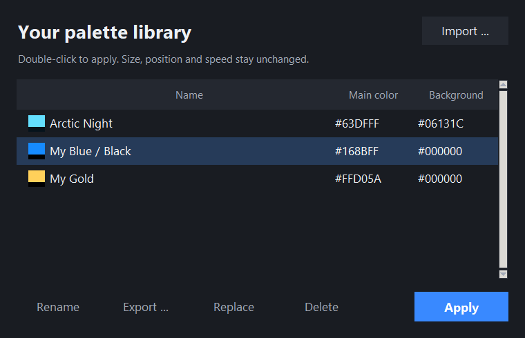

# Native Boot Studio

Ein Windows-Editor zum Umfärben der modernen, nativen Xbox-360-Bootanimation. Erstelle ein abgestimmtes Farbdesign, prüfe die Vorschau und exportiere eine vollständige `bootanim.xex` für dein vorhandenes RGH/JTAG-Setup.

[English](README.md) · [Anleitung](docs/QUICKSTART.de.md) · [HDD/NAND-Installation](docs/INSTALLATION.de.md) · [Selbst bauen](docs/BUILD.de.md) · [Auf GitHub veröffentlichen](docs/PUBLISHING.de.md)

## Funktionen

- 40 abgestimmte Farbpresets, auch mit dunklen Hintergründen.
- Einzelne Farben für Hintergrund, Wirbel, Kugel-X, Leuchten, Highlights, Szenentönung und XBOX-Schrift.
- Eigene Farbpresets speichern, umbenennen, ersetzen, löschen, importieren und exportieren.
- Unterstützte Einstellungen für Größe, Position und Animationsgeschwindigkeit.
- Optionale Shader-Vorschau mit der Originalanimation in Xenia, Wiedergabesteuerung und Originalvergleich.
- Englische und deutsche Oberfläche, Rückgängig/Wiederholen und gespeicherte Projekte.
- Export einer vollständigen XEX für einen vorhandenen nativen HDD-Lader oder die NAND-Image-Erstellung.

Bearbeitet wird die unterstützte moderne Animation. Frei erstellte Bewegungsabläufe, eigene Schrifttexte und die klassische Bootanimation werden nicht unterstützt. Das Programm installiert oder flasht nichts auf die Konsole.

## Erste Schritte

1. Lade die **Windows-x64-ZIP** von der Releases-Seite dieses Repositorys herunter.
2. Entpacke sie in einen beschreibbaren Ordner und starte `NativeBootStudio.exe`.
3. Wähle unter **Dateien** deine originale moderne `bootanim.xex` aus Dashboard/Kernel **17559** sowie dein eigenes **XexTool 6.3**.
4. Wähle optional `xenia.exe` für die Shader-Vorschau. Die [getestete offizielle Xenia-Version](https://github.com/xenia-project/release-builds-windows/releases/tag/v1.0.2844-master) wird separat heruntergeladen.
5. Prüfe die Eingabe, wähle ein Preset, passe es an und exportiere die Animation.

Das öffentliche Paket enthält das Programm, Anleitungen und Lizenzhinweise seiner Laufzeitkomponenten. **Microsoft-Bootdateien, XexTool und Xenia stellt der Nutzer separat bereit.** Siehe [Weitergabe und Lizenzen](docs/DISTRIBUTION.de.md).

Unter **Eigene Presets** kannst du Farben als `.nbpalette.json` speichern und teilen. Sichere den Ordner `UserPresets`, bevor du den Programmordner ersetzt. Projekte verwenden `.nbstudio.json` und können lokale Dateipfade enthalten.

## Vorschau und Export

Die Shader-Vorschau führt den ursprünglichen Renderer in einem Emulator aus. Die Modellvorschau ist eine Annäherung. Emulation garantiert keine exakt gleiche Darstellung auf der Konsole; das Endergebnis und verändertes Timing zwischen Animation und Audio müssen auf Hardware geprüft werden. Die Vorschau lässt den normalen Bootton und die Übergabe an das System aus.

Für HDD-Exporte muss bereits ein nativer HDD-Lader eingerichtet sein. Der NAND-Export liefert eine XEX für deinen bestehenden Image-Build-Ablauf, kein vollständiges NAND-Image. Bewahre das Original und eine funktionierende Wiederherstellungssicherung auf. Modifizierte XEX-Dateien benötigen eine geeignete RGH/JTAG-Konsole.

## Quellcode

| Ordner | Inhalt |
| --- | --- |
| `src/` | Programm, Farbanpassung, Vorschau, Übersetzung und Presetverwaltung |
| `tests/` | Unittests und optionale Integrationstests mit eigenen Originaldateien |
| `scripts/` | Windows-Build und Zusammenstellung der ZIP-Pakete |
| `docs/` | Deutsche/englische Anleitungen und Versionshinweise |
| `licenses/` | Lizenzhinweise für Komponenten der Windows-EXE |

Nach Installation von `requirements.txt` startet `python src/studio.py` die Anwendung. Details stehen in der [Build-Anleitung](docs/BUILD.de.md), im [Prüfbericht](docs/VALIDATION.md) und in der [Vorschau-Dokumentation](GPU-Preview-Implementation.md).

## Lizenz und Beteiligte

Der Native-Boot-Studio-Quellcode steht unter der [MIT-Lizenz](LICENSE). Sie erteilt keine Rechte an Xbox-Software, XexTool oder Xenia. Weitere Hinweise stehen in [NOTICE.md](NOTICE.md).

XexTool stammt von xorloser; Xenia ist ein eigenständiges Emulatorprojekt. Dieses Projekt ist nicht mit Microsoft, xorloser oder dem Xenia-Team verbunden und wird von ihnen nicht unterstützt. [Änderungen](CHANGELOG.md).
