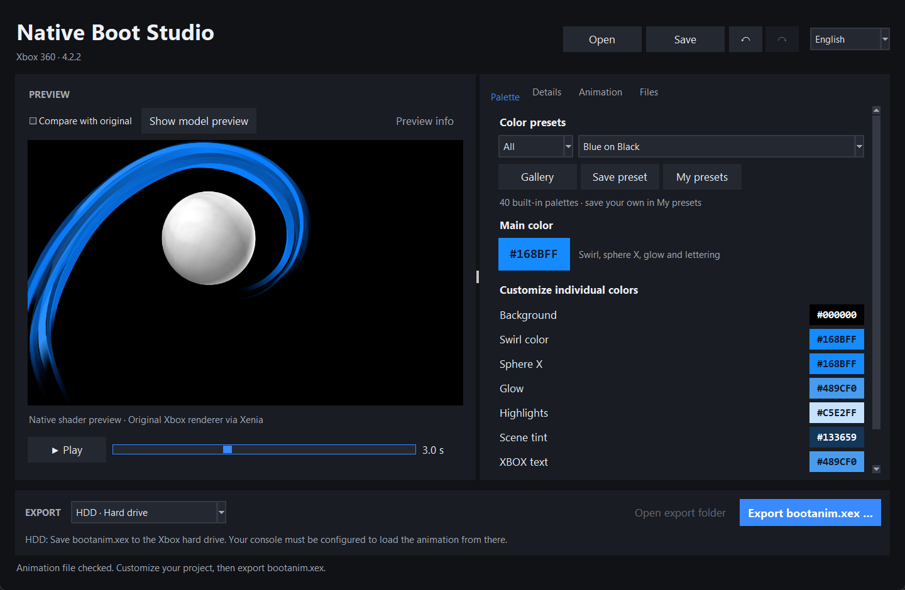
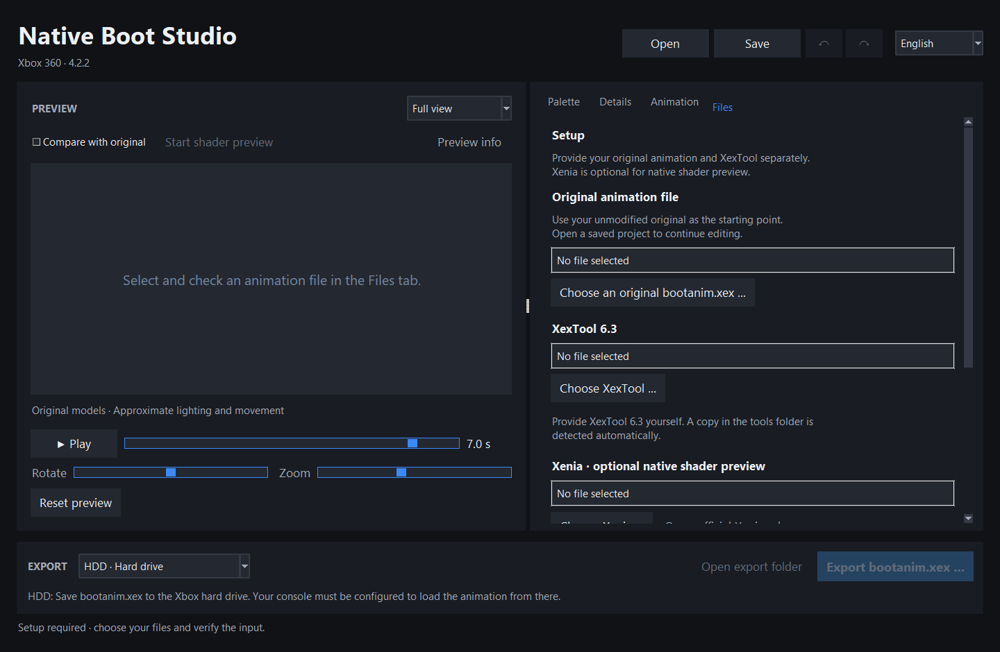
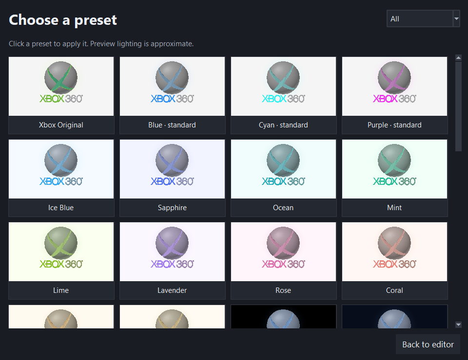
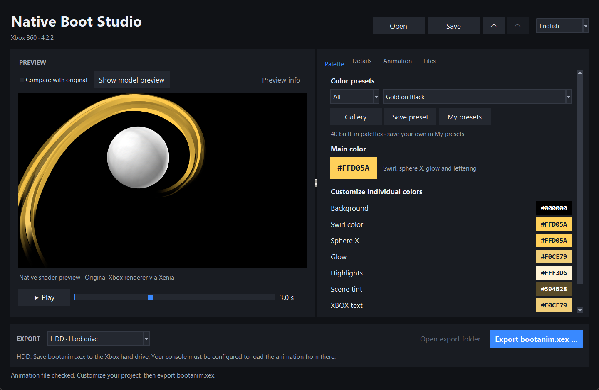

# Native Boot Studio

Passe die Farben der modernen Xbox-360-Bootanimation an, prüfe dein Design am PC und exportiere eine `bootanim.xex` für deine RGH/JTAG-Konsole.

**[Download für Windows](https://github.com/Devine3DS/NativeBootStudio/releases/latest)** · **[English tutorial](README.md)**



*Blau auf Schwarz in Native Boot Studio 4.2.2, dargestellt mit der nativen Shader-Vorschau über Xenia.*

Diese Anleitung führt dich vom ersten Start bis zur Installation deiner Animation. Unterstützt wird die **moderne Bootanimation aus Dashboard/Kernel 17559**. Die klassische Animation wird nicht unterstützt.

## 1. Herunterladen und einrichten

Du benötigst:

- Einen Windows-PC mit x64 und die **Windows-x64-ZIP** über den Downloadlink oben. Python musst du nicht installieren.
- Deine eigene **unveränderte moderne 17559-`bootanim.xex`**.
- **XexTool 6.3** zum Einlesen und Exportieren der Animation.
- Optional: [Xenia für Windows](https://github.com/xenia-project/release-builds-windows/releases/tag/v1.0.2844-master) für die Shader-Vorschau. Dafür brauchst du eine kompatible Grafikkarte und einen Treiber mit Direct3D-12-Unterstützung.
- Eine Xbox 360 mit RGH/JTAG und Dashboard **17559**, um die exportierte Animation zu verwenden.

Der Windows-Download enthält Native Boot Studio und die Anleitungen. Die originale Xbox-Datei, XexTool und Xenia werden separat benötigt.

1. Lade **NativeBootStudio-4.2.2-Windows-x64.zip** unter [Releases](https://github.com/Devine3DS/NativeBootStudio/releases/latest) herunter.
2. Entpacke die gesamte ZIP in einen Ordner, in dem du Dateien speichern kannst, und starte `NativeBootStudio.exe`.
3. Wähle oben im Fenster **English** oder **Deutsch**.
4. Öffne **Dateien** und wähle deine originale `bootanim.xex` sowie `xextool.exe` aus.
5. Für die Shader-Vorschau entpackst du den vollständigen Xenia-Download in einen separaten Ordner und wählst dessen `xenia.exe` unter **Dateien** aus.
6. Klicke auf **Eingabe erneut prüfen**. Nach erfolgreicher Prüfung kannst du exportieren. Das Programm merkt sich die ausgewählten Dateipfade für den nächsten Start.

Verwende als Eingabe ein unverändertes Original, keine bereits exportierte Farbvariante.

<details>
<summary>Screenshot: erster Start und Dateiauswahl</summary>



Nach der Auswahl zeigt der Reiter nur Dateinamen an. Windows-Benutzernamen und Ordnerpfade bleiben in der Oberfläche ausgeblendet.

</details>

## 2. Dein Farbdesign erstellen

1. Öffne **Palette**, wähle eine Presetgruppe und anschließend eines der 40 Presets. Für eine blaue Animation mit schwarzem Hintergrund wählst du **Dunkel → Blau auf Schwarz**.
2. Klicke auf das große Farbfeld unter der Presetauswahl, um Wirbel, Kugel-X, Leuchten und XBOX-Schrift gemeinsam umzufärben.
3. Passe darunter die einzelnen Farben an: **Hintergrund**, **Wirbelfarbe**, **X auf der Kugel**, **Leuchteffekt**, **Helle Effekte**, **Grundfarbe der Animation** und **XBOX-Schriftzug**. Weitere Effekt- und Lichtfarben findest du unter **Details**.
4. Unter **Details** und **Animation** kannst du die unterstützten Einstellungen für Anordnung und Animationsgeschwindigkeit verändern.
5. Spiele die Animation ab und vergleiche sie mit dem Original. Mit Rückgängig/Wiederholen kannst du deine Änderungen durchgehen.



*Wähle aus 40 integrierten Farbpaletten. Die Vorschaubilder der Galerie verwenden die Modellvorschau mit angenäherter Beleuchtung.*

Wenn Xenia eingerichtet ist, klicke auf **Shader-Vorschau starten**. Die Vorschau verwendet den ursprünglichen Renderer, die Shader, Texturen und Kamerafahrt mit deinen Einstellungen. Ohne Xenia steht dir die Modellvorschau zur Verfügung, die die Animation annähert. Nach Änderungen kann die Shader-Vorschau kurz neu starten. Prüfe das fertige Ergebnis auf deiner Konsole: Die Darstellung im Emulator kann abweichen, und eine andere Animationsgeschwindigkeit verändert den Bootton nicht.

<details>
<summary>Screenshot: Gold auf Schwarz in der nativen Shader-Vorschau</summary>



Dieselbe Animation mit abgestimmter goldener Farbpalette und schwarzem Hintergrund, gerendert über Xenia.

</details>

Bearbeitet wird die bestehende Animation. Eigene Ersatztexte und vollständig neue Animationsabläufe sind nicht verfügbar.

### Eigene Presets speichern

Öffne **Eigene Presets** und speichere die aktuellen Farben unter einem Namen. Dort kannst du gespeicherte Presets anwenden, umbenennen, ersetzen, löschen, importieren und exportieren. Zum Teilen verwendest du `.nbpalette.json`-Dateien.

Presets enthalten Farben; Größe, Position und Geschwindigkeit bleiben unverändert. Mit einem `.nbstudio.json`-Projekt speicherst du die weiteren Editoreinstellungen. Sichere vor einem Programmupdate den Ordner `UserPresets` neben der EXE.


*Beispiel für gespeicherte Farbpaletten unter Eigene Presets, mit Funktionen zum Anwenden, Umbenennen, Ersetzen und Teilen.*

## 3. bootanim.xex exportieren

Klicke auf **bootanim.xex exportieren …**, wähle den Speicherort und das passende Ziel dafür, wo deine Konsole die Datei laden soll:

| Ziel | Wo die Konsole die Animation lädt | Installation |
| --- | --- | --- |
| **HDD** | Hauptverzeichnis der internen Festplatte: `Hdd:\bootanim.xex` | HDD-Remap einmal in das NAND-Image einbauen. |
| **NAND** | Flash-Dateisystem im NAND-Image | NAND-Image mit der exportierten XEX und ihrem CRC-32 neu bauen. |

Nenne die exportierte Datei **`bootanim.xex`** und warte auf die erfolgreiche Exportprüfung. **Ausgabe öffnen** zeigt dir die Datei und ihren Bericht. Projekte und Preset-JSONs verwendest du im PC-Editor; auf der Konsole wird die exportierte XEX verwendet.

Native Boot Studio exportiert die Animationsdatei. Zum Kopieren auf die HDD oder zum Bauen und Flashen des NAND-Images verwendest du deine vorhandenen Konsolenwerkzeuge wie unten beschrieben. Sichere vorher deinen funktionierenden NAND-Dump, CPU-Key, die originale Bootdatei und deine Builder-Einstellungen. Verwende die für deine Konsole bereits geprüften Mainboard-, NAND- und Hack-Einstellungen.

## 4A. Auf der internen HDD installieren

Im [Release von Xbox360BootAnimationCreator](https://github.com/TheOnlyLordVirus/Xbox360BootAnimationCreator/releases/tag/Release) liegt `remap_bootanim_17559.bin`, dort **Mena** zugeschrieben. Der Patch wird separat heruntergeladen und liegt unserem Release nicht bei.

1. Exportiere dein Theme im Studio mit Ziel **HDD** als `bootanim.xex`.
2. Sichere eine vorhandene HDD-Bootdatei und kopiere den Export ins **Hauptverzeichnis der internen Festplatte**. Dateimanager zeigen es üblicherweise als `Hdd:\bootanim.xex` oder `Hdd1:\bootanim.xex`. USB-Laufwerke oder Unterordner sind nicht das dokumentierte Ziel dieses Remaps.
3. Ist genau dieser Remap bereits eingerichtet und lädt von dort, brauchst du für ein neues Theme kein neues NAND-Image: HDD-Datei ersetzen und neu starten.
4. Andernfalls lade beim verlinkten Release **nur die Remap-Datei** herunter. Lege sie in deiner separaten xeBuild-/J-Runner-Installation unter `xeBuild\17559\bin\remap_bootanim_17559.bin` ab.
5. Lade deinen eigenen NAND und CPU-Key im Image-Builder und behalte die richtigen Mainboard-/Hack-Einstellungen bei. Ergänze beim Bauen diesen Patchparameter:

   ```text
   -a remap_bootanim_17559
   ```

   Der Parameter nennt den Patch **ohne `.bin`**. Der übrige funktionierende Build-Befehl und notwendige RGH3-Konvertierungsschritte bleiben erhalten. Das Xenon-/JTAG-Beispiel des Release-Autors ist kein passender Befehl für eine Corona mit RGH3.
6. In J-Runner with Extras lassen sich eigene Befehle unter **Advanced → XeBuild Command…** eingeben. Dort kommen nur xeBuild-Parameter hinein, nicht `xeBuild.exe`. J-Runner ergänzt Daten-/Ausgabepfade selbst; `-d` und den Ausgabedateinamen weglassen. Übernimm alle relevanten Parameter deines vorhandenen Setups. **Bei RGH3 darfst du nicht voraussetzen, dass dieser Custom-Command-Weg die normale automatische RGH3-Nachkonvertierung ausführt. Lade das gebaute Image als Source und konvertiere es vor dem Flashen über Advanced → Convert to RGH3 mit korrektem Mainboard/CPU-Key und deinen bewährten Einstellungen.**
7. Prüfe im erfolgreichen Build-Log den Remap und stelle sicher, dass das fertige Image zu deiner Konsole und ihrem Hacktyp passt. Flashe das vollständige Image mit dem passenden Verfahren für dein Mainboard/NAND und starte mit angeschlossener interner HDD neu.

Nach der Einrichtung genügt für weitere Farbänderungen ein neuer **HDD**-Export und das Ersetzen von `Hdd:\bootanim.xex`. Verlasse dich nicht darauf, dass der Remap bei fehlender HDD/Datei auf die NAND-Animation zurückfällt.

## 4B. Direkt im NAND installieren

Hier bleibt die Animation im NAND. Dieser Weg benötigt den normalen NAND-Bootpfad **ohne `remap_bootanim_17559`**. Ein Austausch der NAND-Datei wirkt nicht, solange der Kernel weiterhin auf die HDD umleitet.

1. Exportiere im Studio mit Ziel **NAND** als `bootanim.xex`.
2. Arbeite in einer gesicherten Kopie deiner xeBuild-/J-Runner-Installation. Lade deinen NAND-Dump/CPU-Key und wähle deine korrekten Konsoleneinstellungen sowie Dashboard **17559**.
3. Lege die exportierte XEX in dieser Builder-Kopie unter `xeBuild\17559\bootanim.xex` ab.
4. Ermittle die tatsächlich verwendete Firmware-INI. Bei einem normalen 17559-Glitch2-Build ist es `xeBuild\17559\_glitch2.ini`, bei JTAG `_jtag.ini`. Andere Buildprofile können andere INIs verwenden; prüfe das Build-Log.
5. Ändere in deren Abschnitt `[flashfs]` ausschließlich den CRC-32-Wert des Eintrags `bootanim.xex` auf den Wert **deines exportierten NAND-Files**. Alle übrigen Einträge und Abschnitte bleiben erhalten. Das Format lautet:

   ```ini
   bootanim.xex,DEIN_8_STELLIGER_CRC32
   ```

   `DEIN_8_STELLIGER_CRC32` ist ein Platzhalter und darf nicht so übernommen werden. Das mitgelieferte Hilfsskript berechnet den Wert in PowerShell, ohne die Datei zu verändern:

   ```powershell
   powershell.exe -NoProfile -ExecutionPolicy Bypass -File .\scripts\crc32.ps1 -Path 'C:\MyExports\bootanim.xex'
   ```

   Starte den Befehl im entpackten Programm-/Source-Hauptordner. Der Execution-Policy-Parameter gilt nur für diesen Hilfsskript-Prozess. Übernimm die acht ausgegebenen Hex-Zeichen in die INI. CRC-32 ist nicht die SHA-256-Prüfsumme aus dem Studio-Bericht. Berechne ihn nach jedem neuen Export erneut.
6. Baue das NAND-Image mit deinem normalen Ablauf inklusive notwendiger RGH3-Schritte und **ohne den Remapparameter**. Kontrolliere, dass das Log deine Ersatzdatei mit passendem CRC verwendet und der Build erfolgreich endet. Wird das Original verwendet, ein CRC-Fehler gemeldet oder reicht der Flash-Dateisystemplatz nicht, nicht flashen; korrigiere zuerst Eingabe und Buildprofil.
7. Stelle danach Original-INI und ursprüngliche Builder-Datei wieder her, damit spätere Images das Theme nicht versehentlich übernehmen. Prüfe das fertige Image für deine Konsole, flashe es mit deinem passenden Verfahren und starte neu.

Ersetzt wird die Datei in einem neu gebauten NAND-**Image**. Keine vermeintlichen Raw-Offsets im Dump mit einem Hexeditor ändern und nicht die laufende `Flash:`-/`SFC:`-Bootdatei im Dashboard-Dateimanager löschen, um den Dateisystem-Neubau zu umgehen.

## Zwischen den Wegen wechseln und Ergebnis prüfen

- **HDD → NAND:** Image ohne Remap bauen und den NAND-Export mit passendem CRC einbauen. Eine vorhandene HDD-Datei zu behalten beendet die Kernelumleitung nicht.
- **NAND → HDD:** HDD-Export verwenden und Remap wie in Abschnitt 4A einbauen.
- Erscheint weiterhin das Original, prüfe zuerst tatsächlichen Bootpfad, Exportziel, aktive Firmware-INI, Build-Log und Dateinamen, bevor du erneut Farben änderst.

## Probleme beheben

| Problem | Lösung |
| --- | --- |
| Export ist deaktiviert | Original-XEX und XexTool unter **Dateien** auswählen und **Eingabe erneut prüfen** anklicken. |
| Die Originaldatei wird abgelehnt | Unveränderte moderne 17559-Originaldatei verwenden, keine klassische Animation oder bereits bearbeitete Datei. |
| Shader-Vorschau startet nicht | Entpackte `xenia.exe` auswählen und Windows-/GPU-/Direct3D-12-Unterstützung prüfen. Die Modellvorschau bleibt verfügbar. |
| Einstellungen oder Presets lassen sich nicht speichern | Programm in einen beschreibbaren Ordner entpacken und von dort starten. |
| Die Konsole zeigt weiterhin die alte Animation | Exportziel, tatsächlichen Bootpfad, HDD-Dateinamen bzw. aktive NAND-Build-INI und CRC prüfen. |
| Animation und Ton enden zu verschiedenen Zeiten | Animationsgeschwindigkeit wieder näher an das Original stellen; der Ton wird nicht angepasst. |

Weitere Details: [Benutzeranleitung](docs/QUICKSTART.de.md) · [Installationsanleitung](docs/INSTALLATION.de.md).

## Lizenz und Beteiligte

Native Boot Studio steht unter der [MIT-Lizenz](LICENSE). Für Xbox-Bootdateien und externe Werkzeuge gelten deren eigene Bedingungen; siehe [NOTICE.md](NOTICE.md). XexTool stammt von xorloser, Xenia ist ein eigenständiges Emulatorprojekt und der verlinkte HDD-Remap wird Mena zugeschrieben. Dieses Projekt ist nicht mit Microsoft verbunden.
